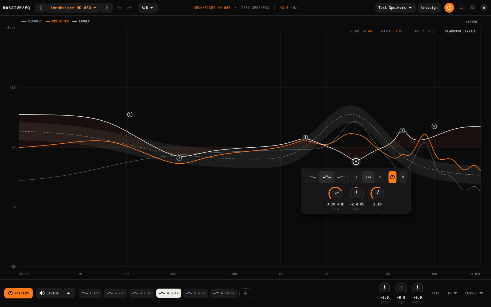
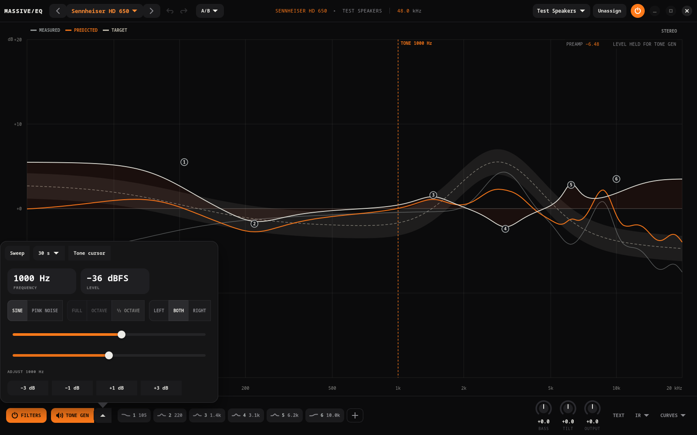
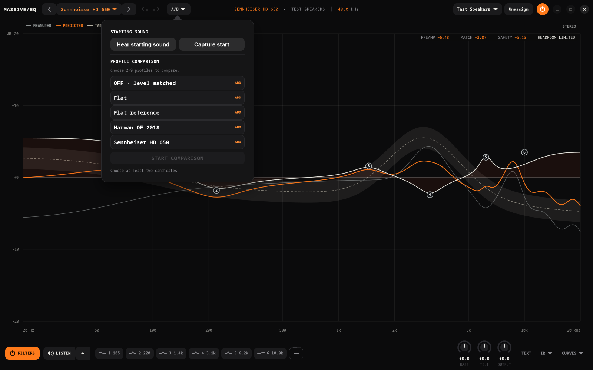
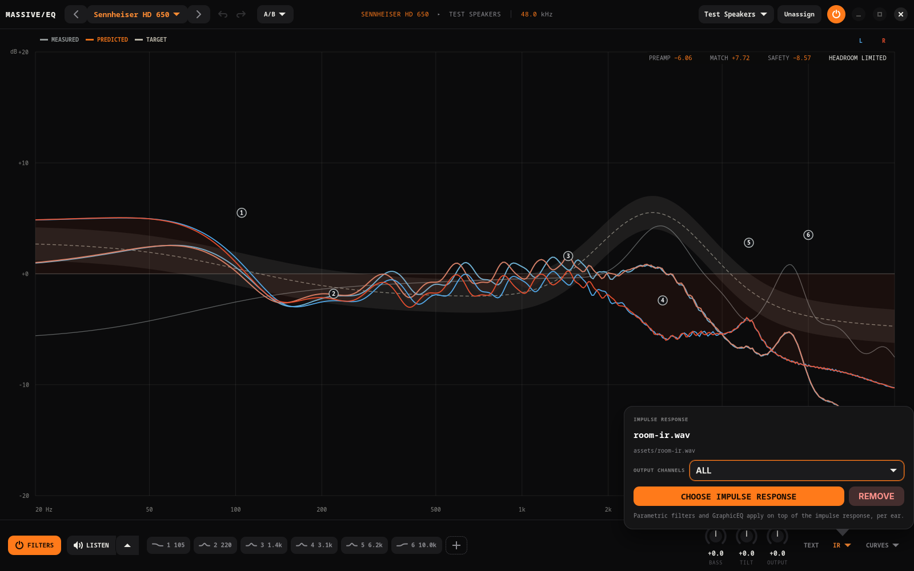
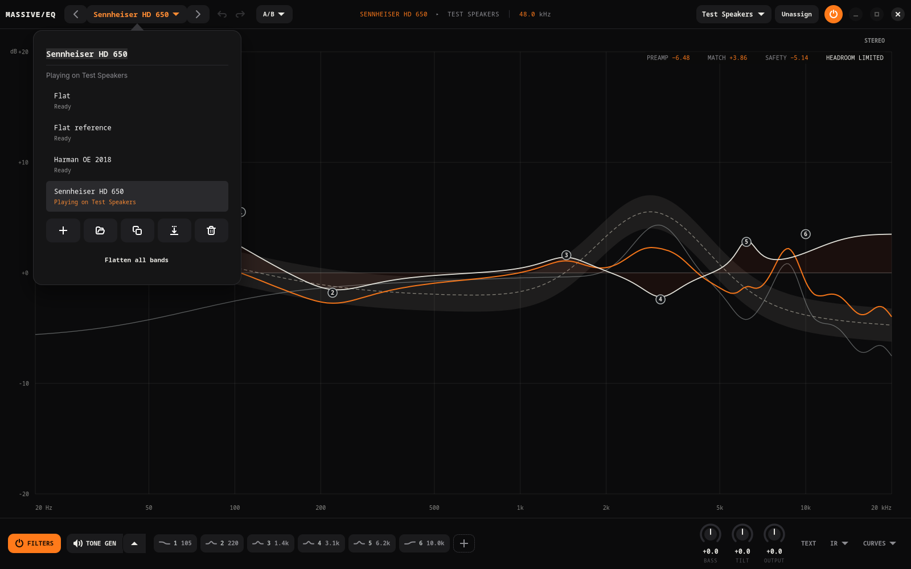

# MassiveEQ

MassiveEQ is a system-wide playback equalizer for Arch Linux audio sessions.
It combines a GTK4/libadwaita profile editor with a user-level service that
places PipeWire smart filters in front of assigned output devices.

**Recommended installation:** `yay -S massiveeq-git` ·
[View the AUR package](https://aur.archlinux.org/packages/massiveeq-git)

<p align="center">
  <a href="docs/screenshots/editor-overview.png">
    
  </a>
  <br>
  <em>The graph is the editor: drag bands, edit the selected one beside its node, and see the corrected measurement against the target.</em>
</p>

> [!WARNING]
> **Beta 2 software:** MassiveEQ is ready for testing, but its audio routing and
> profile format may still change. Keep an easy way to select the original
> hardware output while testing it.

## Tested on

The current beta has been validated on:

- Arch Linux x86_64 with the niri Wayland compositor
- PipeWire 1.6.8, WirePlumber 0.5.15, GTK 4.22.4, and libadwaita 1.9.2
- Apple AirPods over Bluetooth A2DP and a built-in analog stereo output
- Noctalia/Quickshell StatusNotifier tray registration and live menu state
- PipeWire hotplug/reconnect, simultaneous outputs, service restart/fail-open,
  live filter edits, bypass, and device assignment restoration
- Automated DSP reference tests at 44.1, 48, 96, and 192 kHz

It has **not yet been manually validated** on GNOME, KDE Plasma, surround
outputs, professional multichannel interfaces, or ARM systems. Version
0.3.0-beta.2 should therefore be treated as a public beta, not a
production-stable release. Fully updated Arch Linux x86_64 is the supported
packaging target; partial upgrades and Arch Linux ARM are outside this beta's
support contract.

## Current features

- In-app multi-file measurement imports with separate left/right averages,
  an ear-balanced merged view, and retained original takes. See the
  [measurement import workflow](docs/measurement-imports.md).
**A plugin-style editor**

- The graph is the editor, as in Pro-Q and other audio plugins: double-click
  to add a band, drag it for frequency and gain, scroll over it for Q
- Low shelf, peak, and high shelf bands, as on Squiglink, each drawn as its
  curve shape; the selected band's knobs float beside its node
- Per-ear bands (left, both, right), on/off per band, and undo/redo
- **Bass** (a 105 Hz shelf), **Tilt** (a whole-range slope in dB per octave
  around 1 kHz), and **Output** knobs
- A synchronized Equalizer APO text view (**TEXT**, `Ctrl+E`) with live
  validation
- Resizes down to narrow windows; controls fold into the footer

**Listening and comparing**

- **TONE GEN**: sweep a sine or band of pink noise through the current EQ and
  cut or boost what jumps out, by ear; the output level holds while it plays,
  so each change sounds like exactly that change
- **A/B**: audition the starting sound against your edit, or level-matched
  comparison banks of 2–9 profiles plus dry playback
- Headphone measurement and target (or preference-bounds) curves behind the
  EQ, with the measurement shown as corrected by the current filters, where it
  leaves the bounds highlighted, and repeat placements shown as a band
- Per-output **FILTERS** bypass; the graph dims while you hear unprocessed audio

**Profiles and routing**

- Squiglink, AutoEQ, and common Equalizer APO text profile import
- Parametric EQ, GraphicEQ, preamp, includes, and convolution
- Optional true-stereo (4-channel) and 7.1 virtual-surround (14-channel
  HeSuVi) convolution for speaker and room simulation on headphones; the
  graph shows impulse responses smoothed to a sixth of an octave
- Automatic profile assignment using stable Bluetooth and ALSA identifiers
- Unlimited saved profiles with per-output assignment or an explicit unassigned state
- Multiple simultaneous output devices, bypass, headroom, and level analysis
- A readout of whether playing audio is resampled, and how to avoid it

**Engine**

- Native 32-bit floating-point DSP with allocation-free live processing
- Eight-millisecond click-safe chain changes without removing the audio endpoint
- Rate-aware compilation, high-quality IR resampling, and reported latency
- Wayland-native GTK4 interface and systemd user service
- Optional StatusNotifier tray controls for Noctalia, Waybar, KDE Plasma, and other compatible bars
- Optional native Noctalia 4 and 5 quick-controls panels anchored to the bar

## Screenshots

<table>
  <tr>
    <td width="50%">
      <a href="docs/screenshots/listen-tone-finder.png">
        
      </a>
    </td>
    <td width="50%">
      <a href="docs/screenshots/ab-comparison.png">
        
      </a>
    </td>
  </tr>
  <tr>
    <td align="center"><em>TONE GEN: tune by ear with a sweep or tone</em></td>
    <td align="center"><em>A/B: starting sound and level-matched banks</em></td>
  </tr>
  <tr>
    <td width="50%">
      <a href="docs/screenshots/convolution-ir.png">
        
      </a>
    </td>
    <td width="50%">
      <a href="docs/screenshots/preset-bank.png">
        
      </a>
    </td>
  </tr>
  <tr>
    <td align="center"><em>IR: convolution with EQ on top</em></td>
    <td align="center"><em>The preset bank</em></td>
  </tr>
</table>

More views, including the text editor, curves, narrow windows, and the
Noctalia panel, are in the [screenshot gallery](docs/screenshots.md).

## Install

MassiveEQ targets fully updated Arch Linux x86_64 systems. Partial upgrades are
not supported.

### AUR with yay (recommended)

The default installation path is the rolling `massiveeq-git` AUR package:

```sh
yay -S massiveeq-git
```

The package resolves the required Arch libraries, builds the current upstream
revision with Rust 1.92 or newer, runs the test suite, and installs the editor,
audio service, tray companion, command-line helper, desktop entry, and both
Noctalia adapters.

After installation, launch **MassiveEQ** from the application menu once, or
enable the audio service and generic tray companion directly:

```sh
systemctl --user enable --now massiveeq.service massiveeq-tray.service
```

### AUR without yay

An AUR helper is optional. Install the standard Arch build tools, review the
published `PKGBUILD`, and build the exact same package with `makepkg`:

```sh
sudo pacman -S --needed base-devel git
git clone https://aur.archlinux.org/massiveeq-git.git
cd massiveeq-git
makepkg -si
```

### Updating

Every change merged upstream is published to the AUR with a new version, so
system update tools list MassiveEQ like any other package: cachy-update and
arch-update, `yay -Syu`, `paru -Syu`, and the rest. To update it on its own:

```sh
yay -S massiveeq-git
```

For a manual AUR checkout, run `git pull` in the `massiveeq-git` directory and
then run `makepkg -si` again. Profiles, assignments, comparison banks, and
active routing are stored outside the package and are retained across updates.

The editor checks for a newer upstream revision shortly after launch and every
six hours. When one is available, an **UPDATE** button appears in the header.
**Update now** opens a terminal that runs your AUR helper (`paru`, `yay`, or
`pikaur`, whichever is installed first) so you can review the build and enter
your password there; **Copy command** copies it instead. The app never asks for
administrator privileges itself.

However an update is installed, the audio service and tray notice and restart
on the new version by themselves (the service waits for a playing tone to stop),
and the editor's header button becomes **RESTART**, which saves and reopens it.

If an update installs but the old interface still opens, an earlier manual
install is probably shadowing the package. `which -a massiveeq massiveeqd`
should list only `/usr/bin`; move aside any copies in `~/.local/bin` and any
`massiveeq*.service` files in `~/.config/systemd/user`, then run
`systemctl --user daemon-reload` and `systemctl --user restart massiveeq`.

## Build from source

Direct source builds are intended for development. For a normal system
installation, use either AUR method above so all desktop and service files are
installed together.

```sh
sudo pacman -S --needed base-devel git clang rust gtk4 libadwaita \
  pipewire libpipewire wireplumber libsndfile libsamplerate curl
git clone https://github.com/massiveadam/massiveeq.git
cd massiveeq
cargo build --workspace --release --locked
cargo test --workspace --release --locked
```

Run `target/release/massiveeqd` first, followed by
`target/release/massiveeq`, when testing directly from the source tree.

The rolling `massiveeq-git` AUR package follows new upstream commits whenever
it is rebuilt. Maintainer automation for safely synchronizing packaging changes
is documented in [`packaging/aur/README.md`](packaging/aur/README.md).

The tray companion shows the active profile for each output, switches or
unassigns profiles, controls the per-output Filters switch and master engine,
and opens the full editor. It is a separate process, so stopping it never
changes audio routing.

## Noctalia quick controls

Noctalia 4.7.x and Noctalia 5 can use an optional native MassiveEQ widget
instead of the generic tray icon. It opens a themed, bar-anchored panel with the
master Engine switch, the currently routed output, profile assignment,
per-output Filters, active comparison candidates, and compact frequency, gain,
and Q controls for the active parametric profile. Advanced profile editing
remains in the full application.

The two Noctalia generations have different plugin systems. After installing
the Arch package, use the matching adapter.

For Noctalia 5:

```sh
mkdir -p ~/.local/share/noctalia/plugins/massiveeq
cp -a /usr/share/massiveeq/noctalia-v5/massiveeq/. ~/.local/share/noctalia/plugins/massiveeq/
noctalia msg plugins enable massiveeq/massiveeq
```

Add **MassiveEQ** to the bar in Noctalia settings. The v5 panel uses native
host placement, scaling, click-away dismissal, Escape handling, and monitor/bar
orientation behavior. It displays one connected playback output at a time; if
several are connected, the selector defaults to WirePlumber's current playback
sink and keeps the others available without rendering duplicate cards.

For Noctalia 4.7.x:

```sh
mkdir -p ~/.config/noctalia/plugins/massiveeq
cp -a /usr/share/massiveeq/noctalia-v4/massiveeq/. ~/.config/noctalia/plugins/massiveeq/
```

Restart Noctalia, enable **MassiveEQ** under **Settings → Plugins**, and add its
widget to the bar. Once it is working, avoid duplicate icons by disabling only
the generic tray companion:

```sh
systemctl --user disable --now massiveeq-tray.service
```

The audio engine remains in `massiveeq.service` and is not stopped by this
command. Installation, version selection, complete control behavior, updates,
and troubleshooting are covered in the
[`Noctalia widget guide`](docs/noctalia-widget.md), with concise adapter notes
in the [`Noctalia 5 README`](packaging/noctalia-v5/massiveeq/README.md) and
[`Noctalia 4 README`](packaging/noctalia-v4/massiveeq/README.md). See the
[`screenshot gallery`](docs/screenshots.md) for the widget and full editor.

The desktop-neutral `massiveeqctl` helper used by the widget is also available
for scripts and other bars. Run `massiveeqctl status` for a versioned JSON
snapshot or `massiveeqctl status --watch` for line-delimited live updates.

Profiles live in `~/.local/share/massiveeq/profiles/`; assignments and manual
trims live in `~/.config/massiveeq/state.json`. Unassigned and unsupported
multichannel devices are never intercepted.

## Editing bands

The graph is the editor, as in plugin EQs. Double-click empty space to add a
band and drag a band's node to set its frequency and gain; scroll over it to
change Q. A single click on empty space closes the band panel. The selected band opens a panel beside its node: the filter type,
drawn as its curve shape (low shelf, peak, or high shelf, as on Squiglink),
left/both/right ears, frequency, gain, and Q knobs, an on/off switch, and
delete. Knobs follow the mouse vertically (Shift is finer), take the mouse
wheel, and reset on double-click; the panel holds still while you work in it.
Escape closes the panel.

To delete a band, double-click its node, right-click its node or chip, or
press **Delete** or **Backspace** with it selected; the panel's **×** works
too. **Ctrl+Z** brings it back.

With a band selected, **Up**/**Down** change its gain by 0.1 dB and
**Shift+Up**/**Down** by 1 dB; **Left**/**Right** move its frequency and
**Shift+Left**/**Right** change its Q. Hold a key to go faster. The
chips along the footer list every band, numbered in its ear's colour (blue for
left, red for right) as on the graph, and select it; **＋** adds one. Past one
row the chips wrap onto a second, then scroll.
Profiles with other filter types (high-pass, notch, and so on) still load and
play; their bands show their type and can be switched to one of the three.

The header holds the profile bank (◀ ▾ ▶), undo and redo, **A/B**, the
output picker with its assign action, and the engine switch. The footer
holds **FILTERS**, **TONE GEN**, the bands, the **Bass**, **Tilt**, and
**Output** knobs, and **TEXT**, **IR**, and **CURVES**. While **FILTERS** or
the engine is off, the graph dims: it shows the EQ you would hear, not what
is playing.

## Tuning by ear: the tone finder

**TONE GEN** in the footer plays a test signal through the
selected output's current EQ: a sine, or pink noise across the full range,
one octave, or a third of an octave around the chosen frequency, to the left
ear, right ear, or both; the menu beside it chooses which, and holds the
sweep. Sweep the frequency (a marker follows on the graph)
and listen for spots that jump out or vanish. **−3**, **−1**, **+1**, or
**+3 dB** adds a peak filter there, as wide as what you were hearing, or adjusts
the filter already within a twelfth of an octave. Every signal plays at the
same RMS level, capped at −12 dBFS; start quiet.

While the tone plays, the output level holds where it was when the tone
started. Normally MassiveEQ re-matches loudness after every change, so music
stays equally loud and never clips: boost one band and everything else turns
down. That is right for music but confusing for tones, because the tone you
are comparing against moves too. With the level held, a +3 dB band sounds 3 dB
louder at its frequency and nothing else changes; **A/B** against the starting
sound plays both at the same held level, so the difference is exactly the
difference between the two curves. The readout says **LEVEL HELD FOR TONE
GEN**. Clipping protection steps in only if a boost would clip the tone itself
(it has 11 dB of room below full scale), so pause music while you tune. When
the tone stops, matching resumes. The tone stops when you
turn TONE GEN off, open the text editor, close the window, or within five
seconds if the editor goes away. [Listening workflow and implementation
notes](docs/listening-workflow.md) describe the controls and credit the
research that informed them.

## Measurement and target curves

**CURVES** in the footer shows a headphone measurement and a target
behind the EQ for the open profile. Files are plain text or CSV with one
`frequency, dB` pair per line, as exported by AutoEQ, Squiglink, and REW;
headers and comments are skipped. A target with exactly three numbers per
line (`frequency, low, high`) is drawn as a range, such as preference
bounds. Curves are aligned to 0 dB at 630 Hz ± one octave, as
[GraphWorks](https://graph.headphones.com) aligns them, so bounds and
measurements from there line up the same way. The measurement is drawn twice:
as measured, and with the profile's current EQ applied (per ear when the ears
differ).

Against a range, the corrected curve is judged by where it leaves the bounds,
not by its distance from a single line. Each stretch outside is shaded in
magenta and listed above the graph with how far out it goes, for example
`2.1k–3.4k +2.3`. Anything inside the bounds is a defensible tuning; following
[Headphones.com's re-analysis of Harman's research](https://headphones.com/blogs/features/what-headphone-sound-profiles-do-people-like),
listeners in the dominant group rated several quite different responses nearly
as highly as the Harman target.

**Add placement** adds more measurements of the same headphone, taken after
putting it on again. The graph then shows the median with bands holding the
middle half and 90% of placements, and corrects the median. A feature that
moves a lot between placements is not worth EQ'ing precisely. Loading a new
measurement clears its placements.

Curve details record where each curve came from. The fixture is chosen from a
list (B&K 5128, GRAS 43AG/45CA with the KB50xx pinna, B&K 4128, the IEC 711
coupler) or typed in, and fixtures are recognised however they were written.
Targets and bounds are made for one fixture's ears, so a measurement from
another fixture, say a 711 coupler against 5128 bounds, is flagged rather than
quietly compared. MassiveEQ does not bundle third-party targets or bounds;
import the ones you have rights to use.

Curves are saved with the profile in its `curves/` folder; they are not part
of exported profile text.

## Comparing profiles

Open **A/B** in the header, choose between two and nine
candidates, and select **Start Comparison**. The panel then becomes a set of
listening buttons; selecting one immediately switches to that candidate. `Off`
can be included as a dry candidate. Banks are remembered independently for
each output and do not replace its normal assigned profile. The same menu
auditions the profile's starting sound against the current edit.

Level matching predicts the expected [ITU-R BS.1770-5](https://www.itu.int/rec/R-REC-BS.1770-5-202311-I/en)
K-weighted mean-square energy of stationary pink noise after the complete
left/right transfer response. Every candidate is then attenuation-only matched
to the quietest clipping-safe result in the bank. This gives a deterministic,
content-independent comparison without gain pumping; the manual trim remains
available for listener-specific correction. Exact perceived equality cannot be
guaranteed without the listener's playback SPL and headphone transfer, which
more detailed stationary-loudness models such as
[ISO 532-2](https://www.iso.org/standard/63078.html) require.

While the app is focused, `Alt+1` through `Alt+9` (digit row or keypad, on any
layout) select candidates in bank order. `Ctrl+B` toggles the selected
output's **Filters** switch. Turning
Filters off removes the filters while retaining the active profile's
clipping-safe perceived level and existing PipeWire endpoint. The header **Engine**
switch is deliberately different: Engine Off is true 0 dB dry audio with no
EQ, perceptual correction, safety attenuation, or user trim. Comparison
candidates switch through the live 8 ms crossfade without replacing the
PipeWire endpoint. Processed profiles with incompatible convolution latency
cannot be placed in the same bank.

**TEXT** in the footer swaps the graph for the canonical Equalizer APO-style
profile text. Both edit the same draft and autosave after 300 ms. Invalid
text remains visible for correction while the last valid audio chain
continues playing. `Ctrl+E` toggles the two views.

## Text compatibility

MassiveEQ accepts `Preamp`, the common `Filter` variants (`PK`, `LS`, `HS`,
`LP`, `HP`, `BP`, `NO`, and `AP`), `GraphicEQ`, `Channel`, `Include`, and
`Convolution`. Unsupported commands are reported with their source line and
will not be activated silently. Included files are flattened on import and IR
assets are copied into the profile library.

The audio host maintains a persistent native PipeWire smart-filter pair for
each assigned output. MassiveEQ's Rust DSP engine uses stable biquad cascades,
minimum-phase GraphicEQ FIR design, and a two-stage partitioned convolver.
Convolution assets are decoded with libsndfile and resampled offline with
libsamplerate's highest-quality sinc converter. The real-time callback performs
no allocation, locking, file access, logging, process control, or D-Bus work.

### Advanced: multichannel impulse responses

MassiveEQ is a stereo equalizer first. EQ profiles and ordinary 1- or
2-channel impulse responses never change an output's channel layout. Multichannel
convolution is opt-in: it applies only when a profile loads a 4- or
14-channel file. The layout of a convolution file follows from its channel
count:

| Channels | Layout | Input | How it is applied |
| --- | --- | --- | --- |
| 1 | Mono | Output's own | The same IR on every output channel |
| 2 | Per ear | Output's own | Channel 1 on the left ear, channel 2 on the right |
| 4 | True stereo | Stereo | L→L, L→R, R→L, R→R, summed per ear |
| 14 | HeSuVi 7.1 | 7.1 | Each speaker reaches both ears through its own pair |

Fourteen-channel files use [HeSuVi](https://sourceforge.net/projects/hesuvi/)'s
channel order (`FL-L FL-R SL-L SL-R RL-L RL-R FC-L FR-R FR-L SR-R SR-L RR-R
RR-L FC-R`), the same mapping as PipeWire's `sink-virtual-surround-7.1-hesuvi`.
LFE is heard through the center pair. Multichannel files always feed both ears,
must be the profile's only convolution, and need a stereo output.

A 7.1 profile turns its output's MassiveEQ sink into a visible 7.1 device,
**MassiveEQ 7.1 — *output name***, because games and players only send
surround audio to an output that advertises it. While the physical output is
the system output, the 7.1 sink becomes the system output in its place; when
the profile is unassigned, the physical output is restored. Stereo programme
is upmixed by PipeWire as for any 7.1 sink. Turning **Filters** off keeps the
7.1 sink and plays a standard downmix (center and surrounds at −3 dB, LFE
dropped). Level matching and headroom for these files use the paths stereo
programme takes; full-scale content on every surround channel at once can
still exceed them. Matrix routes use uniformly partitioned convolution sized
to the PipeWire quantum, which keeps per-callback cost steady.

On the graph, an impulse response's contribution is power-averaged over a
sixth of an octave, as measurement tools show room responses; EQ bands are
drawn exactly. Headroom and level matching use the unsmoothed response.

A profile can combine an impulse response with parametric filters and
GraphicEQ: the EQ applies on top, per ear (for a multichannel IR, after its
speakers are folded into the two ears), so a room or speaker IR and headphone
correction live in one profile. Equalizer APO applies commands in file order;
MassiveEQ always applies EQ after the IR, which gives the same result for 1-
and 2-channel files. A profile that references a missing IR, exceeds the
device Nyquist rate, or fails headroom analysis remains an editable draft while
the last valid audio chain continues playing.

## Diagnostics

The status strip in the header shows the PipeWire graph rate and whether
playing audio arrives at that rate (`SOURCE NATIVE`) or is converted
(`SOURCE 44.1 kHz → RESAMPLED`). Its tooltip explains the cause; most often
PipeWire is allowed only one rate, which `default.clock.allowed-rates` fixes.

`massiveeqd --self-test-node NODE_NAME` creates a temporary bypass filter for a
specific PipeWire sink and reports buffer and processing statistics. The D-Bus
`Status` method reports active rates, latency, CPU deadline use, buffer health,
and any candidate activation error.
