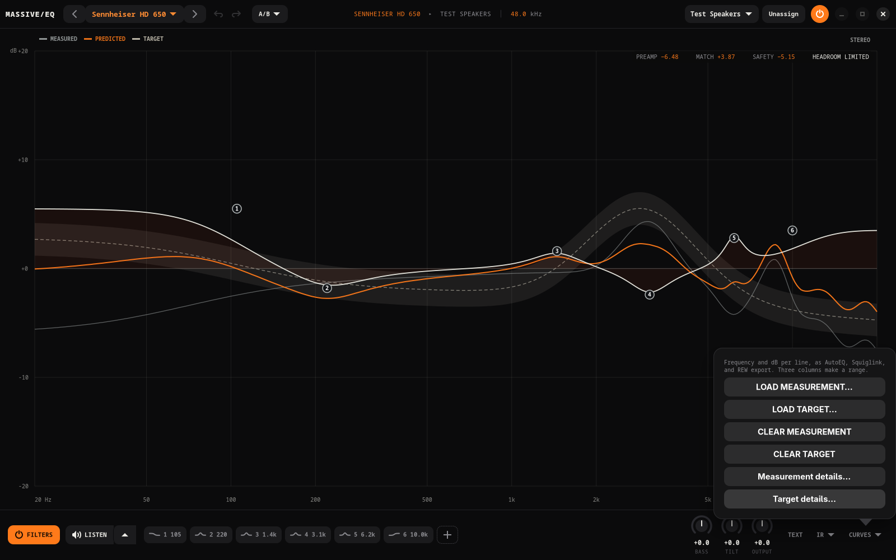
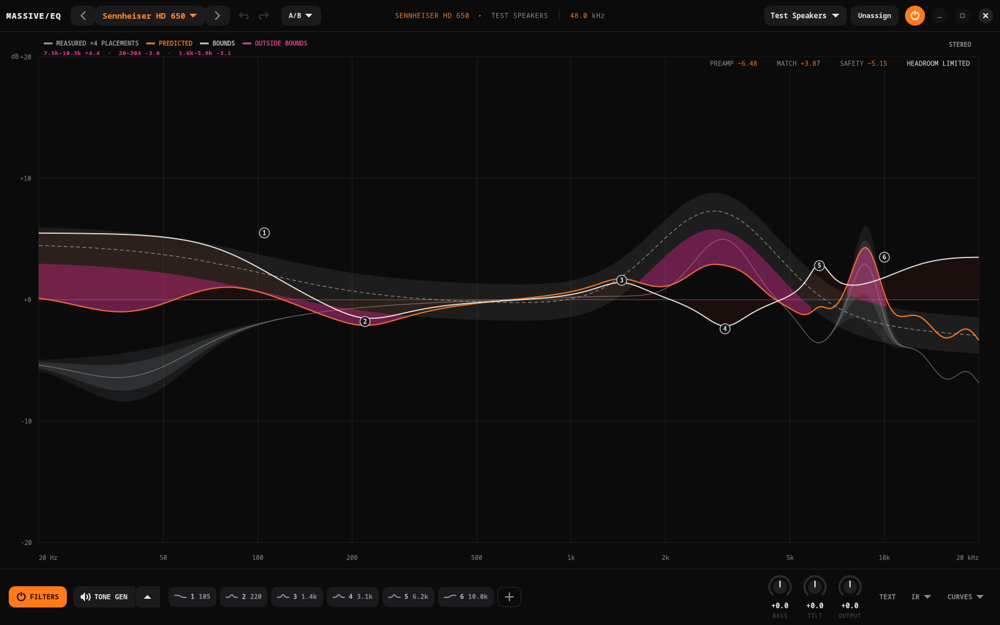
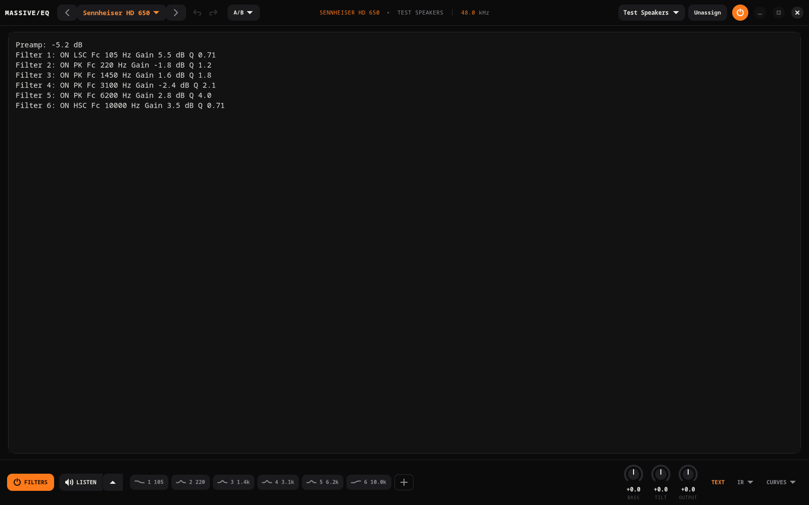
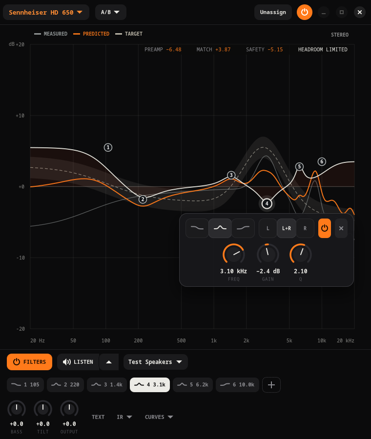
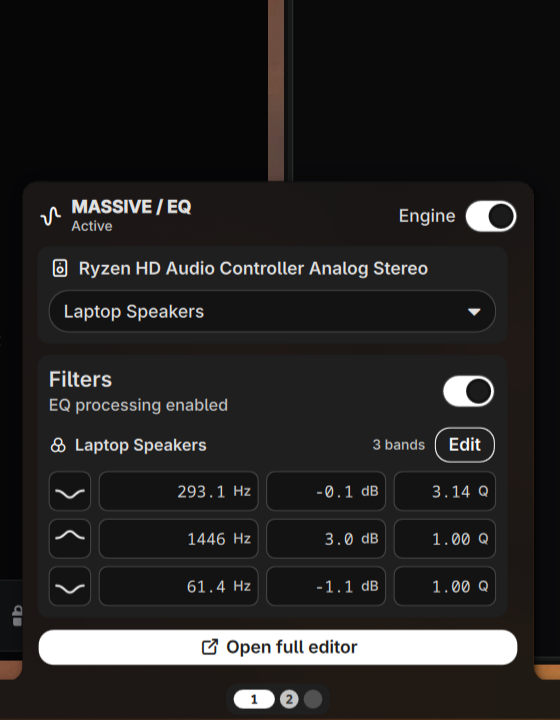
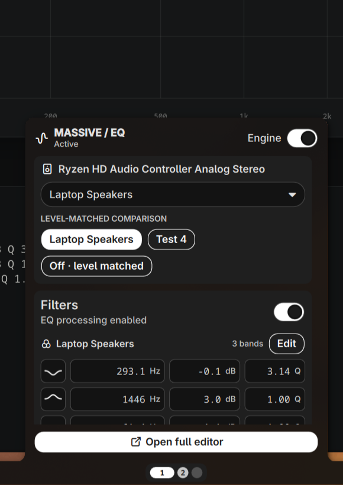
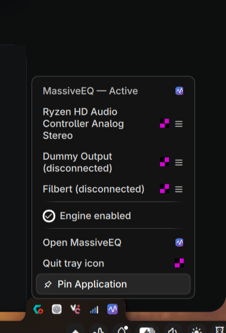

# MassiveEQ screenshot gallery

The editor screenshots come from the current beta in a headless Arch Linux
session (sway, PipeWire, WirePlumber, GTK4/libadwaita) driving the real app.
The headphone measurement, target, and impulse response are synthetic
fixtures, not real measurements. The Noctalia and tray views were captured on
a niri desktop with Noctalia 4.7.7.

## Editor

The graph is the editor. Double-click to add a band, drag it for frequency and
gain, and scroll over it for Q. The selected band's panel floats beside its
node: low shelf, peak, or high shelf, the ears it applies to, frequency, gain,
and Q knobs, an on/off switch, and delete. The footer lists every band, with
the **Bass**, **Tilt**, and **Output** knobs beside them.

## TONE GEN: the tone finder

**TONE GEN** plays a sine or band of pink noise through the current EQ, and a
marker follows it on the graph. The menu beside it holds the sweep, level,
signal, ears, and one-click corrections at the held frequency.

## A/B

**A/B** auditions the starting sound against the current edit and builds
level-matched comparison banks of two to nine profiles, with an optional dry
candidate.

## Preset bank

The profile name opens the bank: rename, switch, create, import, duplicate,
export, delete, and flatten every band. ◀ and ▶ step through profiles.

## Measurement and target curves

**CURVES** loads a headphone measurement and a target or target range, adds
placements, and records where each came from.

Against preference bounds, the stretches where the corrected curve leaves the
range are shaded magenta and listed above the graph. Four placements of the
measurement are drawn as a band around their median.

## Impulse responses

**IR** loads a convolution file; parametric filters apply on top of it, per
ear. The graph shows the impulse response smoothed to a sixth of an octave.

## Text

**TEXT** (`Ctrl+E`) swaps the graph for the profile's Equalizer APO-style
text. Both edit the same draft; invalid text stays visible while the last
valid audio chain keeps playing.

## Narrow windows

In narrow windows the output picker and controls move into the footer and the
band chips scroll.

## Noctalia quick controls

The panel exposes the master engine, current output, profile assignment,
per-output Filters switch, and compact frequency, gain, and Q controls.

## Noctalia comparison controls

An active comparison bank appears directly in quick controls for immediate,
level-matched switching without opening the editor.

## Generic tray fallback

The generic StatusNotifier companion remains available for non-Noctalia bars
and can coexist with the audio daemon independently.
